<picture>
  <source media="(prefers-color-scheme: dark)" srcset="./assets/banner-dark.svg">
  
</picture>

<p align="center">
  <a href="https://www.dawidgebara.pl"></a>
  <a href="https://www.linkedin.com/in/dawgeb00"></a>
  <a href="https://www.dawidgebara.pl/blog"></a>
</p>

### 👋 About me

I build interfaces people actually enjoy using — currently as a **Frontend Engineer at Sopra Steria**, working on an AI product where RAG is part of the daily routine. Before that I spent time at **TEXT S.A. (LiveChat)** on OpenWidget and the Chat Widget.

Right now I'm going **fullstack with .NET**, and after hours I run **Smart Code Solutions** — websites, SEO audits and data scraping for small businesses.

```csharp
var dawid = new Developer
{
    Role     = "Frontend Engineer @ Sopra Steria",
    Previous = ["TEXT S.A. (LiveChat) — OpenWidget, Chat Widget"],
    Daily    = ["React", "TypeScript", "Next.js", "AI / RAG apps"],
    Learning = [".NET", "ASP.NET Core", "EF Core", "SQL"],
    SideGig  = "Smart Code Solutions — websites · SEO · scraping",
    Hobby    = "Fundamental investing on the Warsaw Stock Exchange 📈",
    Based    = "Częstochowa, Poland 🇵🇱",
};
```

### 🛠️ Tech stack

<p>
  <b>Daily</b><br>
  
</p>
<p>
  <b>Leveling up</b><br>
  
</p>
<p>
  <b>Tooling</b><br>
  
</p>

### 🚀 What I'm building

<table>
  <tr>
    <td width="50%" valign="top">
      <h4>🧊 makieta3d</h4>
      Interactive 360° mockups of residential developments with clickable apartments — a reusable viewer built as a vanilla TypeScript web component, fed with real terrain &amp; building data.<br><br>
      
      
      
    </td>
    <td width="50%" valign="top">
      <h4>🌐 <a href="https://www.dawidgebara.pl">dawidgebara.pl</a></h4>
      My business site for Smart Code Solutions — a page that "builds itself" layer by layer (HTML → layout → style → motion), plus a blog for local businesses.<br><br>
      
      
    </td>
  </tr>
  <tr>
    <td width="50%" valign="top">
      <h4>📊 GieldaApi</h4>
      My .NET playground: an ASP.NET Core Web API with EF Core + SQLite, serving Warsaw Stock Exchange companies and quotes. Where frontend habits meet backend.<br><br>
      
      
      
    </td>
    <td width="50%" valign="top">
      <h4>☁️ <a href="https://moko-app.cloud">moko-app.cloud</a></h4>
      Co-developing the moko app.<br><br>
      
    </td>
  </tr>
</table>

### 📌 Open source

<a href="https://github.com/livechat/chat-widget-adapters"></a>

### 📊 Languages



---

<p align="center">
  <sub>💬 Need a website, an SEO audit or a scraper? <a href="https://www.dawidgebara.pl">Let's talk</a>.</sub>
</p>
